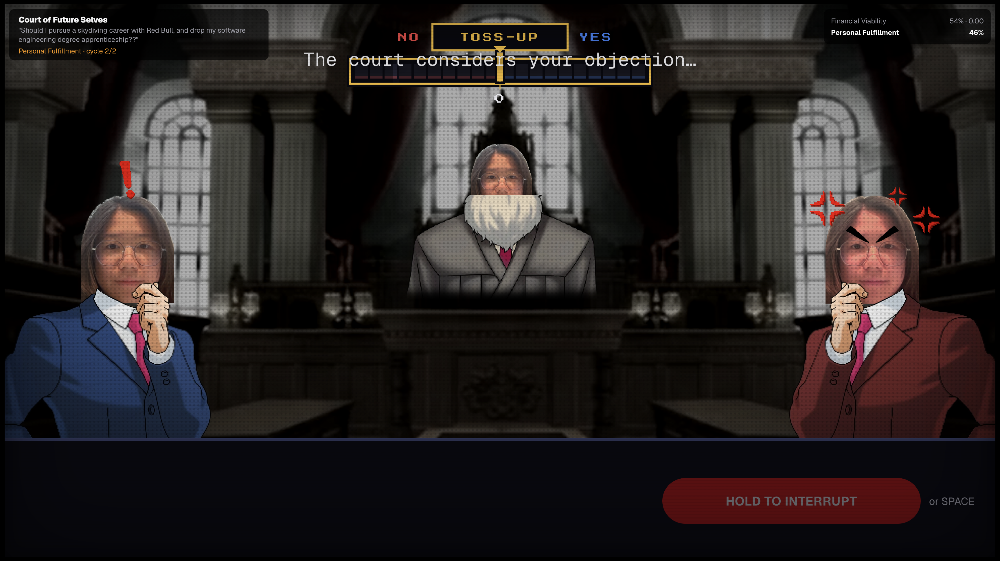
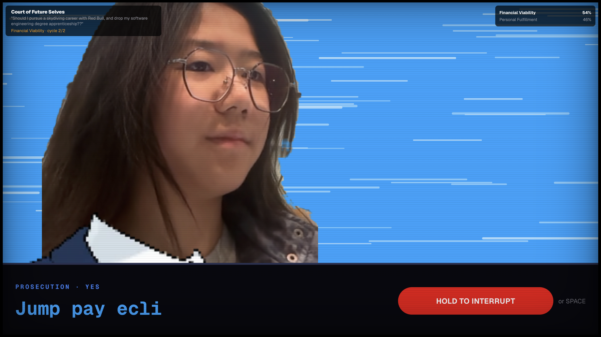
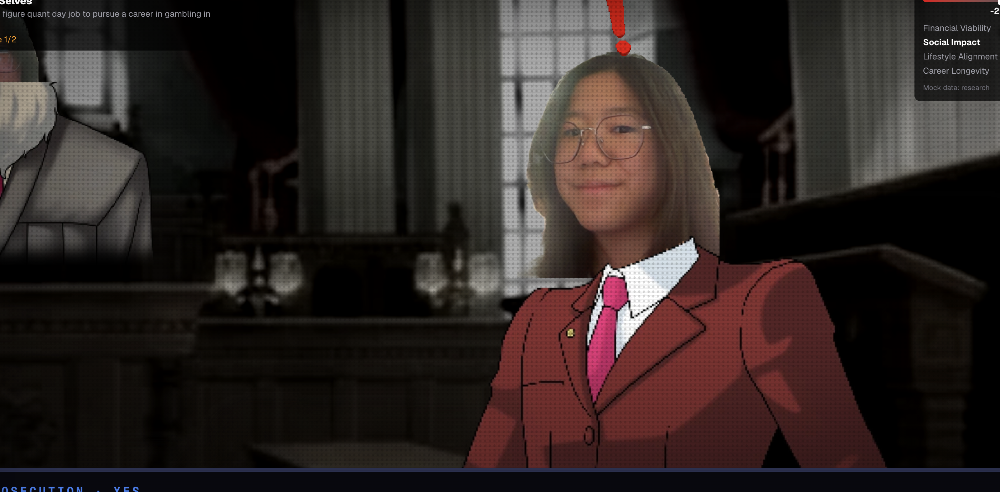
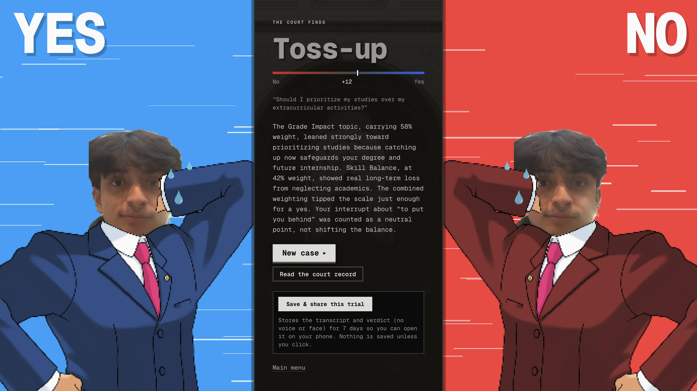

<p align="center">
  
</p>

<h1 align="center">Roulette</h1>

<p align="center"><b>The Court of Future Selves.</b> Ask a life question out loud, and two future versions of you argue it out in your own cloned voice while a Judge rules on real evidence.</p>

<p align="center">🏆 <b>Prize winner at OxHack for its use of ElevenLabs.</b></p>

<p align="center"><a href="https://hackathon-template-vert.vercel.app"><b>Try it live →</b></a></p>

You read a short script, the app clones your voice with ElevenLabs and cuts out your face from a selfie, then you ask a yes/no question ("Should I quit my job to play poker?"). The court opens: YES is the future where it went well, NO is the future where it went wrong. Both speak in your voice, cite researched facts, cut each other off, and you can shout OBJECTION! at any point to argue back. The Judge scores each topic and delivers the verdict.

<table>
  <tr>
    <td></td>
    <td></td>
  </tr>
  <tr>
    <td></td>
    <td></td>
  </tr>
</table>

## Try it

Three ways in, from the menu:

| | What you see | Keys |
|---|---|---|
| **Watch a demo trial** | A real trial, recorded once and replayed: the debate, an objection, the verdict | None |
| **Try a mock trial** | Ask any question; the court plays its scripted mock lines | None |
| **Use your own keys** | The real thing: your question, a real debate, your voice | Yours |

**Bring your own keys.** Open *Use your own keys* on the menu. Keys stay in your browser and go only to this site's own server, for your own requests; they're never stored or logged ([`lib/keys.ts`](lib/keys.ts)).

| Key | What it does | Cost |
|---|---|---|
| [Groq](https://console.groq.com/keys) or [Gemini](https://aistudio.google.com/apikey) | Writes the debate | Free tier is plenty (a trial is about 6 calls) |
| [ElevenLabs](https://elevenlabs.io/app/settings/api-keys) | The voices, transcription, cloning your voice | Free plan: speech in a stock voice. **Cloning your own voice needs Starter or above** |
| [Anthropic](https://console.anthropic.com/settings/keys) (optional) | Writes the debate with Claude instead | Paid |

Tip: make an ElevenLabs key just for this site, restricted to Text to Speech, Speech to Text and Voices, with a credit limit. A full trial uses a few thousand credits.

## Built with

- **ElevenLabs**: Instant Voice Clone, `eleven_v4` text-to-speech with audio tags and per-role voice settings, Scribe speech-to-text, and the Sound Effects and Music APIs for every sound in the courtroom
- **Next.js 16** on Vercel, Tailwind CSS 4, Framer Motion
- **Groq / Gemini** to write the debate; Exa search for public-source evidence
- **Supabase** for returning users and shareable trial links
- MediaPipe face landmarks for the selfie head cut-outs

## Run locally

```bash
npm install
vercel env pull .env.local   # or copy .env.example to .env.local and add your keys
npm run dev                  # http://localhost:3000
```

Use Chrome: the onboarding needs the microphone and camera. Without keys the app still runs end to end on mock data, so `DEBATE_LLM=mock npm run dev` costs nothing.

**Deploying publicly?** Set `HOUSE_KEYS=off` so your own keys are never used for visitors: everyone brings their own, watches a demo, or plays the mock trial.

**Recording a demo trial** (with keys in `.env.local` and `npm run dev` running):

```bash
node scripts/record-demo.mjs --id my-demo --question "Should I …?" --object "But …"
# add --voice to record the voices too (spends ElevenLabs credits once)
```

Built at OxHack by [@ephemerallyCaden](https://github.com/ephemerallyCaden), [@randodeh](https://github.com/randodeh), [@awckiu](https://github.com/awckiu) and [@Dust-OP](https://github.com/Dust-OP).
